<p align="center"></p>

<h1 align="center">LUNA ☾</h1>

<p align="center"><strong>“Luna, open Spotify.”</strong></p>
<p align="center"><em>A small voice-controlled Windows companion — an early experiment in human–computer interaction.</em></p>

<p align="center">  </p>

> **DAs / First experiments:** Before orchestrating complex agents, I was curious about something much simpler: what would it feel like to control my own PC with my voice?

## What this prototype does

Luna is a **Portuguese-language, rule-based voice assistant** for Windows. It listens through the microphone, requires commands starting with **“luna”**, matches supported phrases, executes desktop actions and plays pre-recorded MP3 responses.

- **Music:** playback controls, next/previous track, shuffle, repeat and volume hotkeys.
- **Desktop:** minimize, maximize, switch or close windows; open Explorer, Calculator or Notepad.
- **Shortcuts:** open YouTube, Google, GitHub and locally configured Spotify or Discord executables.
- **Voice feedback:** map recognized actions to original audio clips in [`vozBase/`](vozBase/).

The implementation is split into [microphone input](voz/reconhecimento.py), [voice responses](voz/fala.py), [desktop commands](sistema/comandos.py) and the [main loop](main.py).

```text
Microphone -> speech recognition -> "luna" prefix -> phrase matching
                                                -> desktop action
                                                -> prerecorded voice response
```

## Running locally

This is an **early personal prototype**, not a ready-to-install app. Review the code and configure it for your computer first.

Requirements: Python on Windows, a microphone, Python packages `SpeechRecognition`, `PyAudio` (or a compatible input backend), `PyAutoGUI` and `playsound`. The Google recognizer used by the prototype **requires an internet connection**.

```powershell
python -m pip install SpeechRecognition PyAudio pyautogui playsound
python main.py
```

**Before running:** [`voz/fala.py`](voz/fala.py) uses an old absolute Windows audio directory. Change `base_path` to the cloned repository's `vozBase` folder. Likewise, [`sistema/comandos.py`](sistema/comandos.py) contains machine-specific Spotify and Discord paths; update those or avoid the associated commands. Microphone permissions, application hotkeys and playback focus also affect behavior.

## Engineering boundaries

- Not an LLM, a general AI agent, a security sandbox or an offline speech recognizer. Commands are **fixed string/regex rules**.
- Actions use `pyautogui`, so they can affect whichever application currently has focus. Review commands before running, especially close-window shortcuts.
- Recognized speech is handled through Google's recognition service; **do not use for private conversations without considering this external service**.
- No documented cross-machine test suite, installation package or current CI is included here. The project should be treated as historical/experimental.

## A project timeline

Luna was one of my first steps toward automation and interactive software. Later projects push the idea further: [MineLife AI](https://github.com/DiogoAbreu01/MineLifeIA) explores persistent memory and evidence-checked actions; [BlueScale](https://github.com/DiogoAbreu01/BlueScale) adds server-side concurrency and strict authorization; [Aurora](https://github.com/DiogoAbreu01/banco-digital) explores transactional integrity.

**Built by [Diogo Abreu (DAs)](https://github.com/DiogoAbreu01)** · Electronics Engineering undergraduate, UNIFEI.
